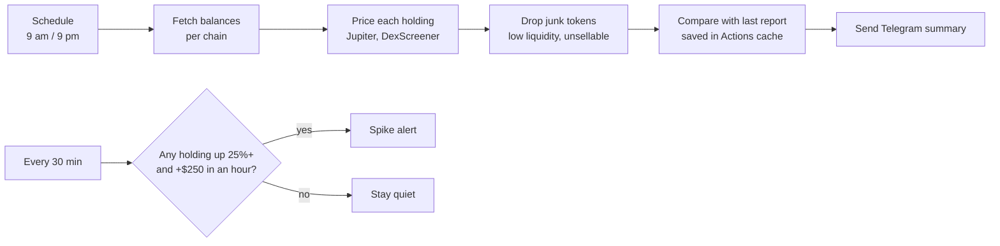

# Portfolio Tracking Notification System

**A scheduled reporting pipeline: twice a day it pulls balances for a list of crypto wallets from two blockchains (Solana and NEAR), prices every holding, filters out junk tokens, compares with the last report, and sends a summary to Telegram. A second job checks prices every 30 minutes and alerts only when a holding spikes. Runs free on GitHub Actions, so no computer has to stay on.**

A personal project I use every day. This public copy has sample settings only; my own copy runs privately with my wallets kept in encrypted GitHub secrets.

```
💼 Portfolio update · Sep 30, 9:00 PM HST
Change vs. last update 12h ago

Main · Solana
$12,480.10  🟢 ▲ +$310.55 (+2.6%)
   SOL $8,201.00 · JUP $2,950.40 · BONK $1,020.12

Savings · NEAR
$3,904.22  🔴 ▼ −$88.10 (−2.2%)
   NEAR (staked) $2,600.00 · NEAR $1,100.50 · STNEAR $203.72
━━━━━━━━━━━━
Total  $16,384.32  🟢 ▲ +$222.45 (+1.4%)
```
*(Sample numbers.)*

## How it works



| Piece | What it does |
|---|---|
| `notifier.py` | The twice-daily report: loads the wallet list, fetches and prices holdings, compares with the previous run, formats and sends the message. |
| `spikes.py` | The 30-minute watcher: keeps an hour of price history and alerts on sharp rises, with a cooldown so one move isn't reported over and over. |
| `chains/solana.py`, `chains/near.py` | One file per blockchain: reads balances (including staked NEAR and Solana token accounts) and gets prices. |
| `chains/common.py` | Shared helpers for web requests and price lookups. |
| `.github/workflows/` | The two schedules that run it on GitHub Actions. |

**Design choices worth calling out:**
- **Secrets never touch the code.** The bot token, the chat ID and the wallet list live in GitHub's encrypted secrets. Locally, they're in files that Git ignores.
- **No balances in the repo.** The previous report's values are kept in the GitHub Actions cache, not committed, so the history of the repo never contains anyone's holdings.
- **Junk filtering.** Airdropped spam tokens can show huge "values." A token is ignored if its trading pool has under $10K of liquidity, or if the holding is worth more than the entire pool, since it could never be sold at that price.
- **One failure doesn't sink the report.** If a wallet or a price source fails, the message says so, leaves that wallet out of the total, and keeps its last value so the next comparison still works.
- **Alerts that don't nag.** Spike alerts are based on price, so moving tokens between wallets never triggers one, and each token goes quiet for 24 hours after an alert unless it climbs another 25%.
- **Easy to extend.** Adding a chain means adding one file with a `fetch_holdings()` function.

## Set it up yourself

Needs a Telegram account and a GitHub account. About 10 minutes.

1. **Create a Telegram bot:** message **@BotFather** → `/newbot`, copy the bot token, then send your new bot any message. Get your chat ID with:
   ```bash
   TELEGRAM_BOT_TOKEN=your_token python3 notifier.py --chat-id
   ```
2. **List the wallets:** `cp wallets.example.json wallets.json` and fill in labels and public addresses. Preview without sending: `python3 notifier.py --dry-run`.
3. **Push to your own GitHub repo** (private recommended), then add these under **Settings → Secrets and variables → Actions**:

   | Secret | Value |
   |---|---|
   | `TELEGRAM_BOT_TOKEN` | from BotFather |
   | `TELEGRAM_CHAT_ID` | from step 1 |
   | `WALLETS_JSON` | the contents of your `wallets.json` |
   | `SOLANA_RPC_URL` | optional: a free Helius RPC URL, which is more reliable than the public one |

4. **Turn on the schedules:** in both files in `.github/workflows/`, remove the `#` marks in front of the `schedule:` lines (they're off in this public copy so it doesn't run without secrets).
5. **Test it:** **Actions → Portfolio report → Run workflow**. The first message says "(first report)"; changes appear from the second run.

Settings (in the `settings` block of the wallet list): `timezone`, `min_liquidity_usd`, `top_holdings`, `min_holding_usd`, and the spike settings `spike_pct`, `spike_min_usd`, `spike_window_min`.

## Limits
- Counts wallet balances only, not positions inside DeFi apps (lending, liquidity pools) or native Solana stake accounts.
- GitHub can start scheduled runs 5–20 minutes late.
- The 30-minute watcher uses about 1,500 of the 2,000 free GitHub Actions minutes a private repo gets per month (public repos have no limit).

*Not financial advice and not a trading tool: it reports what's already in the wallets.*
